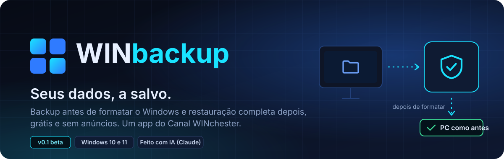
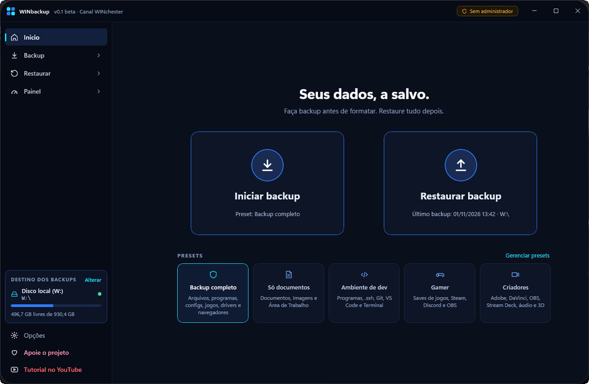
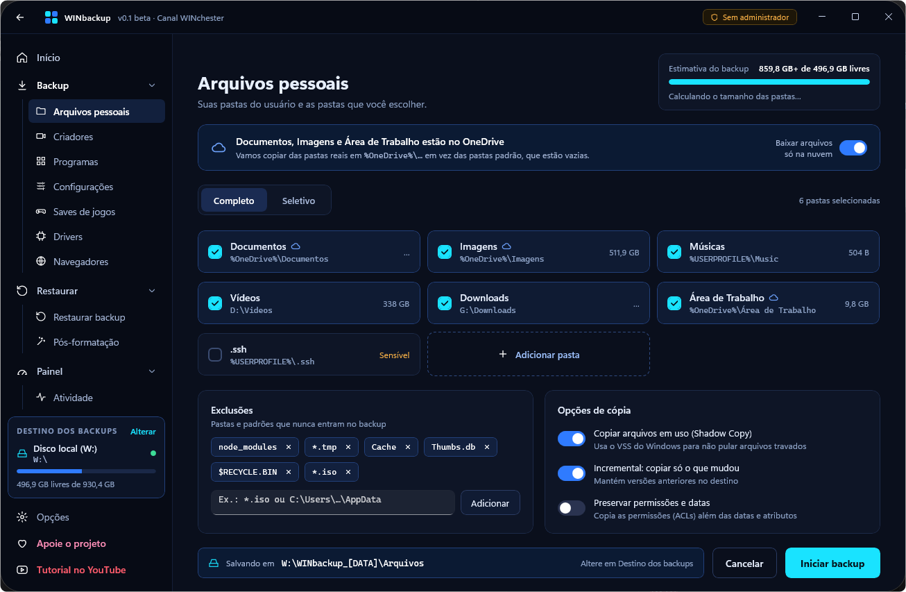
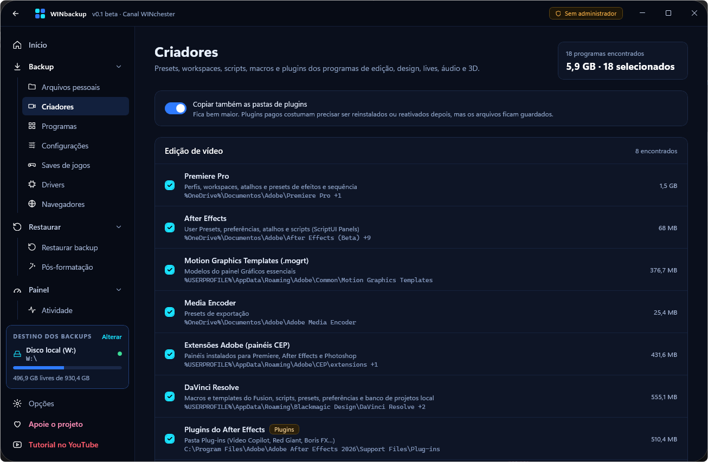
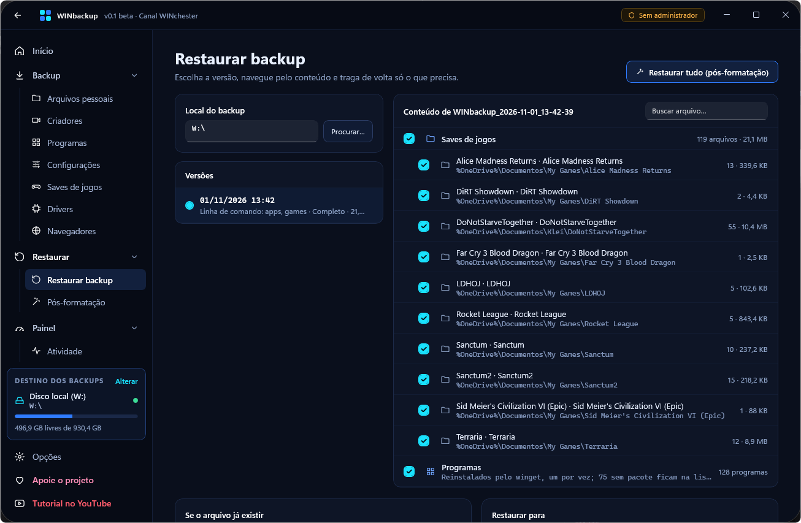
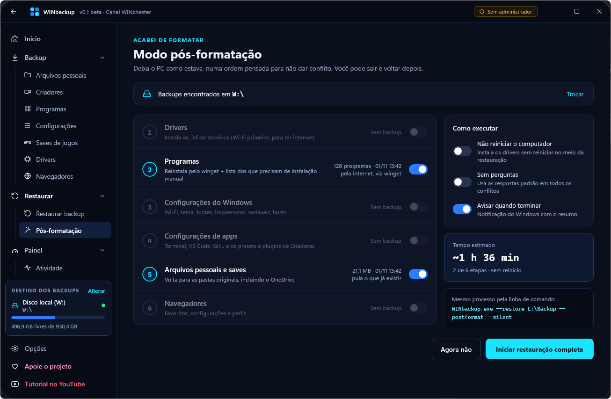
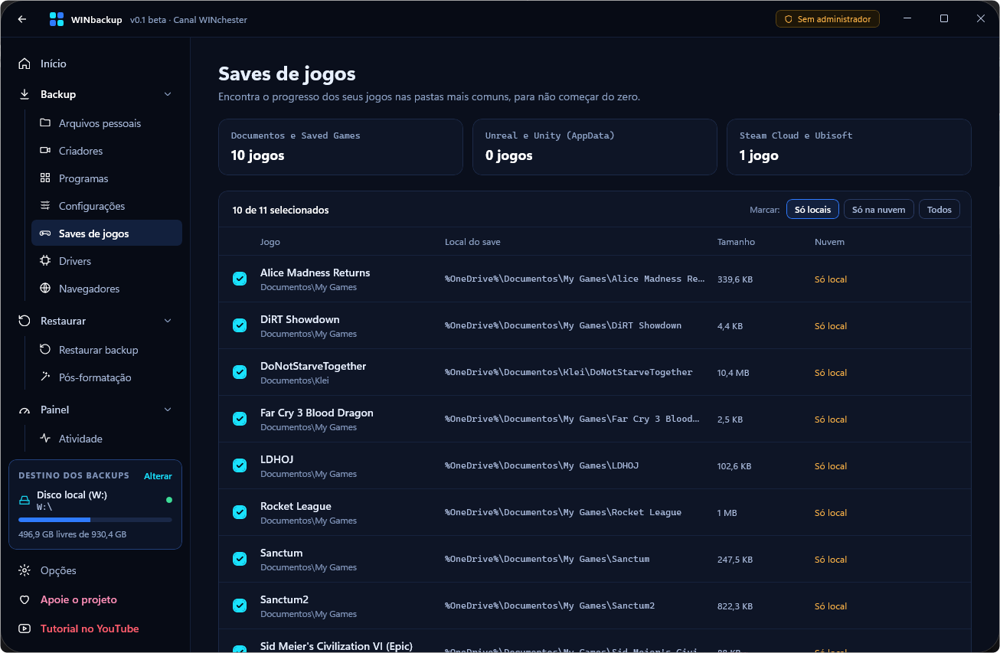

<p align="center">
  
</p>

<p align="center">
  <a href="https://github.com/winchestercanal/WINbackup/releases"></a>
  <a href="https://github.com/winchestercanal/WINbackup/releases"></a>
  
  
</p>

<p align="center">
  <a href="#-baixar-e-testar"><b>Baixar</b></a> ·
  <a href="#-o-que-ele-salva"><b>O que ele salva</b></a> ·
  <a href="#-telas"><b>Telas</b></a> ·
  <a href="#-feedback"><b>Feedback</b></a> ·
  <a href="#-apoie"><b>Apoie</b></a>
</p>

**WINbackup** é um app gratuito para Windows, do **[Canal WINchester](https://www.youtube.com/WINchesterCanal)**, que faz backup de tudo o que importa antes de formatar e deixa o PC como estava depois: arquivos, programas, configurações, saves de jogos, drivers, navegadores e os presets dos seus apps de criação.

<p align="center"><b>Abra, faça o backup e depois restaure. Simples, rápido e eficiente.</b></p>

### 💡 Por que o WINbackup existe

> Durante anos testei inúmeras ferramentas de backup. Todas precisavam de muitos ajustes e nenhuma entregava tudo o que eu precisava, o que me obrigava a usar várias ferramentas para um único propósito.
>
> O WINbackup nasceu para transformar a tarefa cansativa de fazer e restaurar backups de arquivos, programas e drivers em algo **simples, rápido e eficiente**. Você abre, executa o backup e depois restaura.
>
> **Sem configurações complicadas, sem escolhas entre termos difíceis e sem a chance de esquecer alguma coisa e só lembrar quando já é tarde demais.**
>
> — *Canal WINchester*

> [!IMPORTANT]
> 🤖 **Este aplicativo foi criado com inteligência artificial.** O código foi escrito pelo **Claude**, a IA da Anthropic, a partir do protótipo e das decisões do Canal WINchester, que orientou, revisou e testou cada etapa.

> [!WARNING]
> **Versão 0.1 beta, de testes.** Todos os módulos funcionam, mas ainda estamos validando em PCs diferentes. Enquanto testa, **mantenha uma cópia extra dos seus arquivos importantes** e conte pra gente o que encontrar.

<p align="center">
  
</p>

## ✨ Por que o WINbackup

<table>
  <tr>
    <td width="33%" valign="top">
      <br>
      <b>Seguro de verdade</b><br>
      <sub>Confere cada arquivo com SHA-256, copia arquivos em uso pela Shadow Copy do Windows e nunca envia nada para a internet.</sub>
    </td>
    <td width="33%" valign="top">
      <br>
      <b>Pós-formatação guiada</b><br>
      <sub>Depois de formatar, restaura drivers, programas, configurações e arquivos na ordem certa, com um clique.</sub>
    </td>
    <td width="33%" valign="top">
      <br>
      <b>Pastas comuns, sem prisão</b><br>
      <sub>O backup fica em pastas normais no HD externo, outro disco ou na rede. Dá para abrir e copiar sem o app.</sub>
    </td>
  </tr>
  <tr>
    <td valign="top">
      <br>
      <b>Incremental com versões</b><br>
      <sub>Copia só o que mudou e mantém as últimas versões. Você escolhe de qual dia restaurar.</sub>
    </td>
    <td valign="top">
      <br>
      <b>No automático</b><br>
      <sub>Agende por horário, ao conectar o HD externo ou ao entrar no Windows.</sub>
    </td>
    <td valign="top">
      <br>
      <b>Portátil</b><br>
      <sub>Não precisa instalar. Roda direto da pasta ou de um pendrive.</sub>
    </td>
  </tr>
</table>

## 🔄 Como funciona

<table>
  <tr>
    <td align="center" width="33%">
      <br>
      <b>1. Faça o backup</b><br>
      <sub>Escolha um preset (completo, documentos, dev, gamer ou criadores) e o destino.</sub>
    </td>
    <td align="center" width="33%">
      <br>
      <b>2. Formate o PC</b><br>
      <sub>Seus dados ficam guardados no HD externo, em pastas comuns.</sub>
    </td>
    <td align="center" width="33%">
      <br>
      <b>3. Restaure tudo</b><br>
      <sub>Abra o WINbackup no Windows novo e use o modo Pós-formatação.</sub>
    </td>
  </tr>
</table>

## 📦 O que ele salva

| Módulo | O que faz |
|---|---|
| <br>**Arquivos pessoais** | Documentos, Imagens, Área de Trabalho, Downloads e as pastas que você escolher. Detecta pastas no OneDrive e mantém as pastas vazias |
| <br>**Criadores** | Presets, workspaces, scripts e plugins de Premiere, After Effects, Photoshop, Illustrator, Lightroom, DaVinci Resolve, OBS, Stream Deck, Voicemeeter, Blender e outros |
| <br>**Programas** | Lista o que está instalado via winget, reinstala tudo sozinho depois de formatar e gera a lista dos que precisam ser instalados à mão |
| <br>**Navegadores** | Favoritos, configurações e perfis de Edge, Chrome, Brave, Vivaldi, Opera e Firefox, mais a lista de extensões com link da loja. Senhas: exportação guiada, o app nunca as lê |
| <br>**Configurações** | Redes Wi-Fi, tema e papel de parede, impressoras, fontes, variáveis de ambiente e hosts, mais Terminal, PowerShell, VS Code, Git e outros |
| <br>**Saves de jogos** | My Games, Saved Games, jogos Unreal e Unity, Steam Cloud e Ubisoft |
| <br>**Drivers** | Exporta os drivers de terceiros com PnPUtil e reinstala depois |
| <br>**Restaurar** | Escolha a versão e o que trazer de volta (pastas ou arquivos soltos), para o lugar original, outro usuário ou outra pasta |
| <br>**Agendamentos** | Backups automáticos pelo Agendador de Tarefas do Windows |
| <br>**Linha de comando** | Tudo também roda pelo terminal, para scripts e automações |
| <br>**Temas e idiomas** | Português, inglês e espanhol. Temas WINchester, escuro neutro, preto OLED e claro, em Opções |
| <br>Criptografia | *Em desenvolvimento* |

## 📸 Telas

<table>
  <tr>
    <td width="50%"><p align="center"><sub><b>Arquivos pessoais</b>: pastas do usuário, OneDrive, exclusões e Shadow Copy</sub></p></td>
    <td width="50%"><p align="center"><sub><b>Criadores</b>: presets e plugins de Adobe, DaVinci, OBS e outros</sub></p></td>
  </tr>
  <tr>
    <td><p align="center"><sub><b>Restaurar</b>: escolha a versão e o que trazer de volta</sub></p></td>
    <td><p align="center"><sub><b>Pós-formatação</b>: deixa o PC como estava, na ordem certa</sub></p></td>
  </tr>
  <tr>
    <td colspan="2" align="center"><p align="center"><sub><b>Saves de jogos</b>: encontra o progresso dos seus jogos</sub></p></td>
  </tr>
</table>

## 📥 Baixar e testar

<p align="center">
  <a href="https://github.com/winchestercanal/WINbackup/releases"></a>
</p>

1. Em **[Releases](https://github.com/winchestercanal/WINbackup/releases)**, baixe o `.zip` da versão mais recente.
2. Extraia numa pasta (por exemplo `C:\WINbackup` ou um pendrive). Não precisa instalar nada: o .NET e o Windows App SDK já vêm dentro.
3. Abra o `WINbackup.exe` e aceite o aviso de administrador.

> [!NOTE]
> O Windows pode mostrar **"O Windows protegeu o computador"** porque o app ainda não tem assinatura digital. Clique em **Mais informações → Executar assim mesmo**.

**Primeiro teste seguro:** escolha um destino vazio (pendrive ou pasta de teste), faça backup de uma pasta pequena e restaure em **Restaurar → Outra pasta**.

**Requisitos:** Windows 10 (2004) ou 11, 64 bits. Precisa rodar como administrador (para drivers e Shadow Copy).

## 💬 Feedback

Encontrou um erro ou tem uma sugestão? **[Abra uma issue](https://github.com/winchestercanal/WINbackup/issues/new)** contando:

- o que você fez e o que esperava acontecer;
- a versão do Windows;
- se possível, o log da execução (`backup_audit_….log` dentro da pasta `WINbackup_<data>` do backup, ou `%APPDATA%\WINbackup\logs`) e o arquivo `%APPDATA%\WINbackup\erros.log`.

## ⌨️ Linha de comando

```powershell
WINbackup.exe --preset completo --dest E:\Backup  # backup completo
WINbackup.exe --only apps,configs --silent        # só programas e configurações, sem janela
WINbackup.exe --restore E:\Backup --postformat    # restauração pós-formatação
```

O backup fica em pastas comuns no destino que você escolher, com um `manifest.json` e um log por execução. **Nada é enviado para a internet.**

<details>
<summary><b>🛠️ Compilar a partir do código</b></summary>

<br>

Requer o SDK do .NET 10.

```bash
dotnet publish -c Release -r win-x64 --self-contained true -o publish/WINbackup app/WINbackup/WINbackup.csproj
```

Feito em **WinUI 3** (Windows App SDK) e **.NET 10**. Detalhes da arquitetura, do formato do backup e de como testar sem UAC em [`app/README.md`](app/README.md). O protótipo da interface e as decisões de design estão em [`interface/HANDOFF.md`](interface/HANDOFF.md).

</details>

## 💙 Apoie

O WINbackup é gratuito e sem anúncios. Se ele te ajudou, considere apoiar o projeto:

<p>
  <a href="https://livepix.gg/canalwinchester"></a>
  
  <a href="https://www.youtube.com/WINchesterCanal"></a>
</p>

<p align="center"><sub>Feito com 🤖 IA e 💙 pelo Canal WINchester</sub></p>
